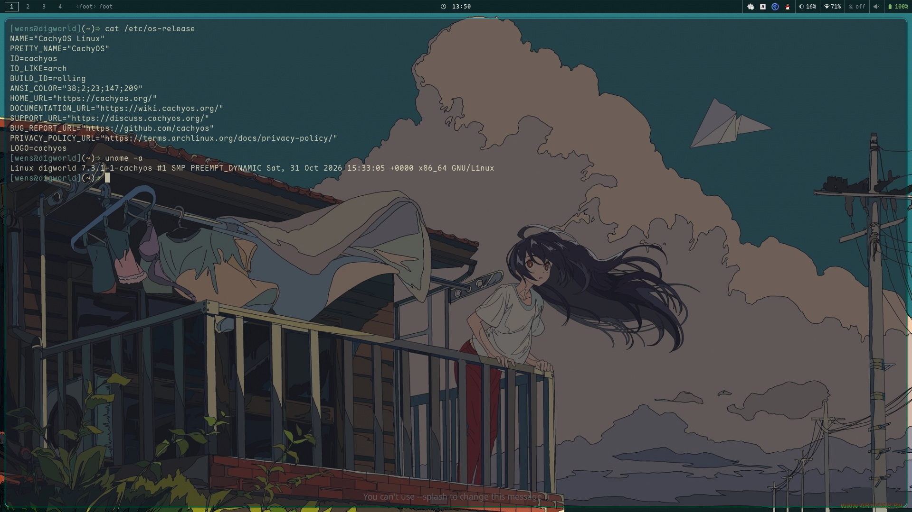
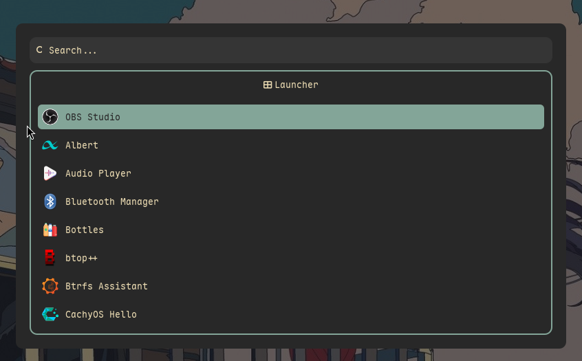

# wensboy's Dotfiles

A lightweight personal configuration that follows the KISS principle throughout, keeping things simple and flexible.

- Minimal: install as few components as the system strictly requires, so the setup fits a personal workflow.
- Source as code: prefer changing the source over configuration — code is the configuration.
- Structured: operations flow through a shared structure, so code can be reused and fine-tuned, making customization fast and simple.
- 1-to-N: define once, deploy to many machines and adapt across distributions.
- Reference: a single repository is the source of truth; configuration is linked in place, so edits need no full reload.
- Zero intrusion: existing configuration is avoided automatically rather than overwritten.

## Usage

```bash
git clone --depth=1 https://github.com/wensboy/dotfiles.git

# distro package set and the entries to link live here
$EDITOR dotfiles/scripts/config.sh

# install packages, precheck targets, link with stow, verify
./dotfiles/init.sh
```

`init.sh` detects the distro from `/etc/os-release`, installs the matching `base` and `wm` package groups (including `stow`), links every entry in `ENTRIES`, then verifies each link points back into the repository.

Entries that already link back into the repository are skipped, so re-running is safe. Any other existing target aborts the run before anything is touched — resolve it first.

## Assets





## Extensions

Every extension is implemented with **rofi and shell scripts**; the related key bindings live in `hypr/modules/keybind.lua`. Currently implemented:
- launcher
- window switcher
- bluetooth
- network
- session menu
- clipboard
- wallpaper switcher

## License

[MIT](./LICENSE)